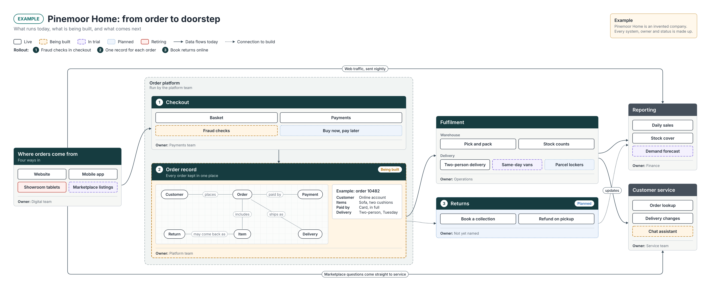
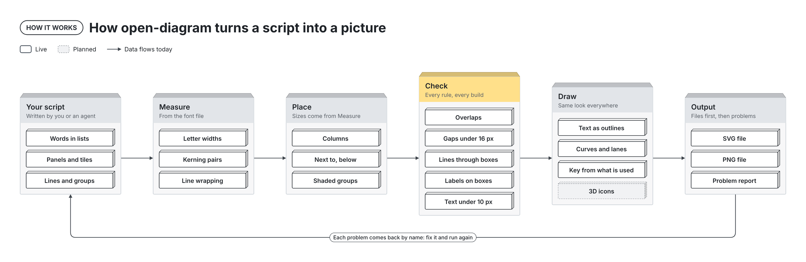

# open-diagram-rs

Rust building blocks for dense architecture diagrams that check their own layout.

Pictures are in [docs/images](docs/images). How it compares with Mermaid, D2, draw.io, Excalidraw and archify: [docs/comparison.md](docs/comparison.md).



You describe panels, tiles, lines and groups in JSON or a Mermaid flowchart, or you build the same picture with the `open-diagram-rs` crate. Every label is measured from the bundled Inter font before anything is placed. If two panels collide or a line runs through a panel, the build says so by name. The output is an SVG and a PNG.

This crate reproduces the diagram behavior of open-diagram 0.6.0. Its package version is 0.1.0. The minimum supported Rust version is 1.100, the same as `rust-toolchain.toml`. CI tests that toolchain. Raising `rust-version` is a minor release.

## Install

```bash
cargo install open-diagram-rs-cli --locked
```

The command is `open-diagram-rs`. In another crate, `cargo add open-diagram-rs` adds the library. For an MCP app, `cargo install open-diagram-rs-mcp --locked` installs the stdio server `open-diagram-rs-mcp`. In Claude Code, `/plugin install open-diagram-rs --marketplace Orrae-Labs/open-diagram-rs` installs the plugin. Connecting a host is in [docs/agents.md](docs/agents.md).

PNG output needs Chrome, Chromium or Edge. If the usual locations miss it, set `CHROME` to the browser path. The SVG is written either way.

## Quick start

```bash
open-diagram-rs new azure_web_app
open-diagram-rs check azure_web_app.json
open-diagram-rs draw azure_web_app.json
```

A diagram written by hand:

```json
{
  "title": "How a search request is answered",
  "tag": "EXAMPLE",
  "columns": [
    [{"id": "app", "title": "Web app", "tiles": ["Search box", "Results page", "Filters"], "footer": "Owner: Web team"}],
    [{"id": "api", "title": "Search API", "tiles": ["Checks access", {"label": "Caches results", "status": "building"}], "footer": "Owner: Platform team"}],
    [{"id": "index", "title": "Search index", "status": "planned", "tiles": ["Product text", {"label": "Spelling fixes", "status": "planned"}]}]
  ],
  "links": [
    {"from": "app", "to": "api"},
    {"from": "api", "to": "index", "kind": "planned", "label": "new"}
  ]
}
```

`open-diagram-rs draw search.json` writes `search.svg` and `search.png`. The same picture is `open_diagram_rs::examples::quickstart` in the library.


## Why a first attempt comes out clean

- Every label is measured before it is placed. Widths come from the font's own spacing and kerning.
- The build names each problem. `draw` writes the files, prints the problems, and exits 1 when any remain. `Diagram::save` returns `LayoutError` with the same list after the files are written.
- Text is drawn as shapes. The SVG looks the same without the font installed. Inter is bundled.
- Words stay apart from layout. Changing a label does not require moving a box by hand.



## Examples

The pictures under [docs/images](docs/images) are rebuilt by `open_diagram_rs::examples::pictures`. JSON and Mermaid inputs that match three of them live in [examples](examples).

| Picture | What it shows |
| --- | --- |
| `systems_map` | A video platform: columns, a group, steps, statuses, owners, a small data map, and lanes |
| `how_it_works` | How open-diagram-rs itself works |
| `pipeline` | A release pipeline, with a rollback lane |
| `card_payment` | A card tap, with return paths above and below |
| `layers` | Stacked layers and a side panel |
| `concept_map` | How git stores a project |
| `smart_home` | A smart home, with a planned overnight path |
| `incident_response` | An outage from the first alert to the lessons learned |
| `business_map` | A furniture store from order to doorstep |
| [email_delivery.json](examples/email_delivery.json) | Email delivery as JSON |
| [signup_flow.mmd](examples/signup_flow.mmd) | A sign-up flow imported from Mermaid |
| [release_cycle.json](examples/release_cycle.json) | A release cycle as a ring |

Draw one with `open-diagram-rs draw examples/email_delivery.json`.

## Docs

| Topic | File |
| --- | --- |
| Rust types | [docs/rust.md](docs/rust.md) |
| JSON keys | [docs/json.md](docs/json.md) |
| Mermaid | [docs/mermaid.md](docs/mermaid.md) |
| Command line and the GitHub Action | [docs/cli.md](docs/cli.md) |
| Agents | [docs/agents.md](docs/agents.md) |
| Cloud templates | [crates/open-diagram/templates/README.md](crates/open-diagram/templates/README.md) |
| Layout problems | [skills/open-diagram-rs/SKILL.md](skills/open-diagram-rs/SKILL.md) |
| Comparison | [docs/comparison.md](docs/comparison.md) |

## Publishing

Crates are published with [crates.io trusted publishing](https://crates.io/docs/trusted-publishing). The workflow exchanges a GitHub OIDC token for a token that lasts about 30 minutes. There is no crates.io API token in the repo.

On a tag `vX.Y.Z` whose numbers match `version` in the three package manifests:

1. [`.github/workflows/crate-provenance.yml`](.github/workflows/crate-provenance.yml) packages each crate with `cargo package --locked` in a job whose token cannot request OIDC. A second job attests those bytes with `actions/attest` and does not run Cargo. The workflow file lives in this repository. The `release` environment, limited to `v*` tags and to its reviewer, is what stops a rewritten workflow from publishing.
2. [`.github/workflows/publish.yml`](.github/workflows/publish.yml) verifies that attestation for this tag, repacks with `cargo package --locked --no-verify`, and continues only when the digest matches. That job does not compile. `cargo publish --locked --no-verify` uploads the pack. Cargo cannot upload an existing `.crate`. The registry token exists only on the publish step. The job then requires the crates.io index checksum to equal the attested digest. The command and the MCP server follow the same way after the library version is in the index.

Before the first publish, a crates.io owner publishes each new name once from a trusted machine and revokes that API token. Then configure a trusted publisher: owner `Orrae-Labs`, repository `open-diagram-rs`, workflow filename `publish.yml`, environment `release`, and turn on "Require trusted publishing". Later tags use the workflow only.

Verify a downloaded `.crate`:

```bash
gh attestation verify open-diagram-rs-0.1.0.crate --repo Orrae-Labs/open-diagram-rs --signer-workflow Orrae-Labs/open-diagram-rs/.github/workflows/crate-provenance.yml --source-ref refs/tags/v0.1.0
```

## Contributing

`cargo test --workspace --all-features`, `cargo clippy --workspace --all-targets --all-features -- -D warnings`, and `cargo audit` are the checks. [AGENTS.md](AGENTS.md) is the map and the invariants.

The library package license is `MIT AND OFL-1.1 AND Apache-2.0 AND CC-BY-ND-2.0`. Code is MIT. The Inter fonts are SIL Open Font License 1.1 (`crates/open-diagram/fonts/OFL.txt`). GCP icons are Apache-2.0. AWS icons, including the QuickSight PNG, are CC BY-ND 2.0. Azure icons also keep Microsoft's icon terms, which are not an SPDX license. See `crates/open-diagram/templates/assets/README.md`.
