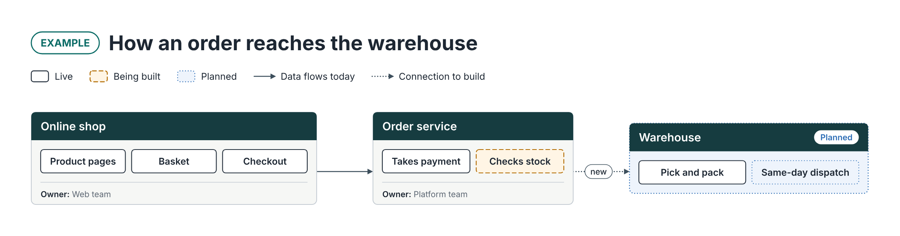

# open-diagram-rs

open-diagram-rs draws architecture diagrams and checks their layout. You describe boxes, lines and groups in JSON, in a Mermaid flowchart, or in Rust. It measures every label with the bundled Inter font, places everything, and names each layout problem it finds: two boxes that overlap, a line that runs through a box, text below 10 px. It writes an SVG and, when Chrome or a Chromium-based browser is installed, a PNG.


There are three ways to use it:

- `open-diagram-rs`, a command for your terminal or CI.
- `open-diagram-rs`, a Rust library.
- `open-diagram-rs-mcp`, an MCP server that lets AI apps such as Claude, Codex or Cursor draw and check diagrams.

## Install

```bash
cargo install open-diagram-rs-cli --locked
```

This installs the `open-diagram-rs` command. It needs Rust 1.100 or later.

PNG output uses Chrome, Chromium or Edge. If yours is installed somewhere unusual, set `CHROME` to its path. Without a browser you still get the SVG.

To use the library in your own crate:

```bash
cargo add open-diagram-rs
```

For the MCP server, see [docs/agents.md](docs/agents.md).

## Draw your first diagram

Start from a template:

```bash
open-diagram-rs new azure_web_app
open-diagram-rs draw azure_web_app.json
```

`new` writes `azure_web_app.json` into the current folder, and `draw` turns it into `azure_web_app.svg` and `azure_web_app.png`. Run `open-diagram-rs new` on its own to list the templates.

Or write one yourself. Save this as `search.json`:

```json
{
  "title": "How a search request is answered",
  "tag": "EXAMPLE",
  "columns": [
    [{"id": "app", "title": "Web app", "tiles": ["Search box", "Results page", "Filters"], "footer": "Owner: Web team"}],
    [{"id": "api", "title": "Search API", "tiles": ["Checks access", {"label": "Caches results", "status": "building"}], "footer": "Owner: Platform team"}],
    [{"id": "index", "title": "Search index", "status": "planned", "tiles": ["Product text", {"label": "Spelling fixes", "status": "planned"}]}]
  ],
  "links": [
    {"from": "app", "to": "api"},
    {"from": "api", "to": "index", "kind": "planned", "label": "new"}
  ]
}
```

Then run `open-diagram-rs draw search.json`:



Each entry in `columns` is a column of panels, drawn left to right. A part marked `building` gets a dashed amber outline and one marked `planned` a dotted gray one. The legend under the title lists the states and kinds of line the picture uses. The same picture in Rust is `open_diagram_rs::examples::quickstart`.

## When the layout has a problem

`draw` and `check` print each problem as a sentence that names the parts involved, for example that one panel overlaps another, or that a line crosses a panel it doesn't connect to. `draw` still writes the files so you can look at them, then exits with status 1. `check` builds the diagram without writing anything, which suits CI.

Labels are never squeezed or cut to make them fit. If a box is too small for its text, the problem says how many pixels it needs.


## Examples

[docs/images](docs/images) holds every example picture. The test suite redraws them all and fails if a single byte changes.

| Picture | What it shows |
| --- | --- |
| `systems_map` | A video platform, with columns, a group, numbered steps, states, owners, a small data map and lanes |
| `how_it_works` | How open-diagram-rs works |
| `pipeline` | A release pipeline with a rollback lane |
| `card_payment` | A card payment, with return paths above and below |
| `layers` | Stacked layers and a side panel |
| `concept_map` | How git stores a project |
| `smart_home` | A smart home with a planned overnight path |
| `incident_response` | An outage, from the first alert to the lessons learned |
| `business_map` | A furniture store, from order to doorstep |
| `aws_etl`, `aws_architecture`, `azure_web_app`, `gcp_event_pipeline` | The cloud templates, drawn with the providers' own icons |

Three have source files in [examples](examples) that you can draw directly:

```bash
open-diagram-rs draw examples/email_delivery.json
open-diagram-rs draw examples/signup_flow.mmd
open-diagram-rs draw examples/release_cycle.json
```

## Documentation

| Topic | Page |
| --- | --- |
| Every JSON key | [docs/json.md](docs/json.md) |
| What a Mermaid flowchart keeps and loses | [docs/mermaid.md](docs/mermaid.md) |
| The Rust API | [docs/rust.md](docs/rust.md) |
| Commands, and the GitHub Action that checks diagrams on every push | [docs/cli.md](docs/cli.md) |
| The MCP server and AI agents | [docs/agents.md](docs/agents.md) |
| Cloud templates and icons | [crates/open-diagram/templates/README.md](crates/open-diagram/templates/README.md) |
| What each layout problem means and how to fix it | [skills/open-diagram-rs/SKILL.md](skills/open-diagram-rs/SKILL.md) |
| How it compares with Mermaid, D2, draw.io, Excalidraw and archify | [docs/comparison.md](docs/comparison.md) |

## Background

open-diagram-rs is a Rust port of [open-diagram](https://github.com/lukendeasy/open-diagram), which is written in Python. It started from open-diagram 0.6.0 and ports later changes from it. The [changelog](CHANGELOG.md) lists each release.

## Contributing

Before opening a pull request, run:

```bash
cargo test --workspace --all-features
```

```bash
cargo clippy --workspace --all-targets --all-features -- -D warnings
```

```bash
cargo audit
```

The tests compare every example picture with the committed copy in `docs/images`, byte for byte. If your change is meant to alter a picture, update the committed SVG and PNG in the same pull request.

[AGENTS.md](AGENTS.md) maps the source files and lists the rules the code keeps, such as determinism and the exact wording of layout problems. Releases are described in [docs/releasing.md](docs/releasing.md).

## License

The code is MIT. The library package also carries the licenses of the files bundled with it, so its license field is `MIT AND OFL-1.1 AND Apache-2.0 AND CC-BY-ND-2.0`:

- The Inter fonts use the SIL Open Font License 1.1 ([crates/open-diagram/fonts/OFL.txt](crates/open-diagram/fonts/OFL.txt)).
- The Google Cloud icons are Apache-2.0.
- The AWS icons, including the QuickSight PNG, are CC BY-ND 2.0.
- The Azure icons also come with Microsoft's icon terms, which have no SPDX identifier.

[crates/open-diagram/templates/assets/README.md](crates/open-diagram/templates/assets/README.md) gives the source and terms of each icon set.
