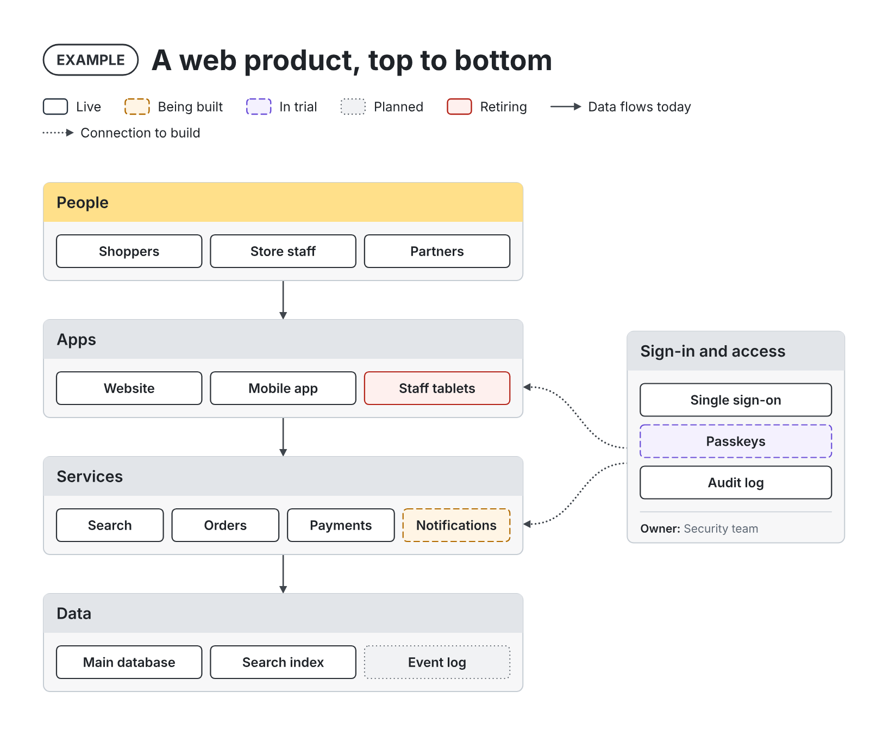
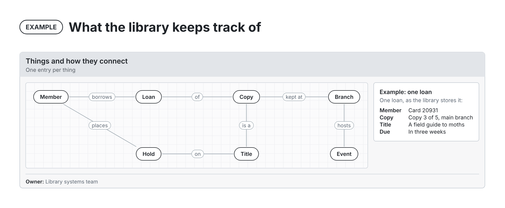

# open-diagram

Python building blocks for dense architecture diagrams that check their own layout.


You describe panels, tiles, lines and groups in a short Python script. open-diagram measures every label from the font, places the blocks, and checks the result. If two panels collide or a line runs through a panel, the build says so by name. The output is an SVG (a picture made of shapes, sharp at any size) and a PNG.

It is built to be written by an AI agent such as Claude, Codex or Cursor, as well as by people. The checks catch layout mistakes before anyone looks at the picture, so a first attempt usually comes out clean.

## Install

```bash
pip install git+https://github.com/lukendeasy/open-diagram
```

open-diagram needs Python 3.9 or later and fontTools, which pip installs for you. To make PNG files it also needs Google Chrome, Chromium or Microsoft Edge. If yours is not in the usual place, set the `CHROME` environment variable to its path. The SVG is always written, browser or not.

## Quick start

```python
from open_diagram import Diagram, Panel, Tile

d = Diagram("How an order reaches the warehouse", tag="EXAMPLE")
shop = d.add(Panel("Online shop", ["Product pages", "Basket", "Checkout"], footer="Owner: Web team"))
orders = d.right_of(shop, Panel("Order service", [Tile("Takes payment"), Tile("Checks stock", status="building")],
                                footer="Owner: Platform team"), align="center")
stock = d.right_of(orders, Panel("Warehouse", ["Pick and pack", Tile("Same-day dispatch", status="planned")],
                                 status="planned"), align="center")
d.link(shop, orders)
d.link(orders, stock, kind="planned", label="new")
d.save("quickstart")   # writes quickstart.svg and quickstart.png
```


The key at the top lists only the statuses and line kinds the picture uses.

## Why a first attempt comes out clean

- **Every label is measured before it is placed.** Widths come from the font's own spacing and kerning, so each box fits its words.
- **The build checks the layout and names each problem.** For example: `'Fulfilment' and 'Returns' are only 9 px apart (minimum 16)` or `line 'Where orders come from' -> 'Fulfilment' crosses 'Returns'; route it with via_x/via_y, move a block, or pass cross_ok=True`. `save()` writes the files, prints a summary, then raises `LayoutError` with the full list.
- **Text is drawn as shapes.** The SVG looks the same in a browser, PowerPoint, Keynote or Figma, with or without the font installed. Inter comes bundled.
- **Words stay apart from layout.** Keep labels in lists at the top of the script. Changing a word does not move anything by hand.

## Examples

Each example is one script in [`examples/`](examples/). Run any of them with `python3 examples/<name>.py`.

| Example | Shows |
| --- | --- |
| [`systems_map.py`](examples/systems_map.py) | Columns, a group, steps, statuses, owner footers, a concept map with a worked example, and lanes above and below the picture |
| [`layers.py`](examples/layers.py) | Stacked layers with a side panel |
| [`concept_map.py`](examples/concept_map.py) | A map of things and how they connect, with a worked example |
| [`quickstart.py`](examples/quickstart.py) | The code above |

<p>
  
  
</p>

## Building blocks

| Block | What it draws |
| --- | --- |
| `Panel(title, *sections, sub=, status=, step=, footer=, tone=)` | The main box: a colored header, sections stacked inside, an optional footer such as "Owner: Data team" |
| `Tiles(items, cols=, label=)` | A grid of tiles with one cell size. A plain list of labels inside a `Panel` becomes `Tiles` |
| `Tile(label, sub=, status=, icon=)` | One small box. `icon` takes a PNG or SVG file you supply |
| `Card(title, rows, intro=)` | A worked example: rows of name and value |
| `Graph(nodes, links, at)` | Things on a grid, joined by labelled lines. The build reports labels that touch nodes |
| `Row(*sections)` | Sections side by side inside a panel |
| `Text(text)` | A wrapped paragraph |
| `Note(title, *lines)` | A boxed note for the top right, such as "Draft" |

| Diagram method | What it does |
| --- | --- |
| `add(block, x, y)` | Place a block at a position |
| `right_of(ref, block, align=)` and `below(ref, block, align=)` | Place a block next to another, with the theme's gap |
| `columns([[...], [...]])` and `stack([...])` | Place columns left to right, each one top to bottom |
| `group(label, members, sub=)` | A shaded, dashed area around some blocks |
| `link(a, b, kind=, label=, start=, end=, via_x=, via_y=)` | An arrow. `kind="planned"` is dotted. `via_y` routes it through a lane, for example above everything |
| `save(path)` | Write the SVG and PNG, print a summary, raise `LayoutError` if there are problems |
| `render()` | Return the SVG text and a report without writing files |

## Statuses, colors and sizes

Panels have light gray headers and yellow step numbers. `tone="accent"` gives a panel a soft yellow header, and `tone="dark"` a charcoal one. Header text turns white by itself on a dark header.

Statuses are shown by color and by word: Live, Being built, In trial, Planned and Retiring. Change them, or anything else, with a `Theme`:

```python
from open_diagram import Diagram, Status, Theme

theme = Theme(tones={"default": "#2B3036", "neutral": "#6A7078", "accent": "#FFC83D", "dark": "#111418"})
theme.statuses["pilot"] = Status("Pilot", stroke="#8E24AA", fill="#F6EDF9", dash="dashed")
d = Diagram("My picture", theme=theme)
```

## Use it with an AI agent

The folder [`skills/open-diagram/`](skills/open-diagram/) is an Agent Skill: instructions an agent loads when it needs them. For Claude Code, copy it into your skills folder:

```bash
cp -r skills/open-diagram ~/.claude/skills/
```

Then ask for a picture in plain words, for example: "Draw a systems map of our checkout, warehouse and reporting, with what is live and what is planned." The skill tells the agent to plan the columns, write the script, run it, fix each named problem, and look at the PNG before it answers.

## Run the tests

```bash
python3 -m unittest discover -s tests
```

## License

MIT, in [LICENSE](LICENSE). The bundled Inter font is by The Inter Project Authors, under the SIL Open Font License 1.1, in [src/open_diagram/fonts/OFL.txt](src/open_diagram/fonts/OFL.txt).
