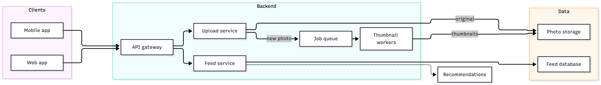

# How open-diagram compares

The same photo upload flow, drawn by each tool from its own format with default settings.

## open-diagram

From [photo-upload.json](https://github.com/lukendeasy/open-diagram/blob/main/docs/compare/photo-upload.json). open-diagram checked the layout before drawing: 0 problems.

## Mermaid

From [photo-upload.mmd](https://github.com/lukendeasy/open-diagram/blob/main/docs/compare/photo-upload.mmd).

## D2

From [photo-upload.d2](https://github.com/lukendeasy/open-diagram/blob/main/docs/compare/photo-upload.d2).

## Excalidraw

From the same [Mermaid file](https://github.com/lukendeasy/open-diagram/blob/main/docs/compare/photo-upload.mmd), through Excalidraw's Mermaid import.

## archify

From [photo-upload.architecture.json](https://github.com/lukendeasy/open-diagram/blob/main/docs/compare/photo-upload.architecture.json). archify's layout checks passed.

## At a glance

| Tool | Input | Layout | Checks layout | Output | MCP | License | Price |
| --- | --- | --- | --- | --- | --- | --- | --- |
| [open-diagram](https://github.com/lukendeasy/open-diagram) | Python, JSON, Mermaid | Automatic | Yes | SVG, PNG | Yes | MIT | Free |
| [Mermaid](https://mermaid.js.org) | Text | Automatic | No | SVG, PNG, PDF | Yes | MIT | Free; paid app from $10 a user a month |
| [D2](https://d2lang.com) | Text | Automatic | No | SVG, PNG, PDF, PowerPoint, GIF | No | MPL-2.0 | Free |
| [draw.io](https://www.drawio.com) | Editor | By hand | Only in its MCP viewer | PNG, SVG, PDF and more | Yes | Apache-2.0 | Free |
| [Excalidraw](https://excalidraw.com) | Editor | By hand | Only in its paid MCP server | PNG, SVG | Yes | MIT | Free; Plus from $6 a user a month |
| [archify](https://github.com/tt-a1i/archify) | JSON | Automatic | Yes | Interactive HTML page | No | Apache-2.0 | Free |

MCP lets AI apps such as Claude and Cursor use the tool directly.

## When another tool fits better

- **Mermaid**, for diagrams that show up inside GitHub, Notion or Obsidian with nothing to install, and for sequence, Gantt and class diagrams.
- **draw.io** or **Excalidraw**, to move boxes by hand or edit with other people at the same time.
- **D2**, for PowerPoint or GIF output.
- **archify**, for a clickable page linked to your code.
