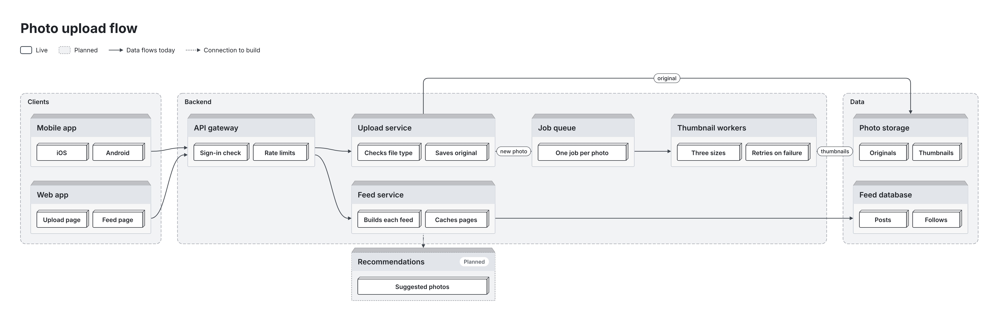

# How open-diagram compares

The same photo upload flow, drawn by each tool from its own format with default settings.

## open-diagram

Made in 0.60 s. 0 layout problems. [Source](https://github.com/lukendeasy/open-diagram/blob/main/docs/compare/photo-upload.json)

## Mermaid

Made in 0.76 s. [Source](https://github.com/lukendeasy/open-diagram/blob/main/docs/compare/photo-upload.mmd)

## D2

Made in 0.017 s. [Source](https://github.com/lukendeasy/open-diagram/blob/main/docs/compare/photo-upload.d2)

## Excalidraw

Made in 0.020 s, inside the browser. From the Mermaid file, through Excalidraw's Mermaid import. [Source](https://github.com/lukendeasy/open-diagram/blob/main/docs/compare/photo-upload.mmd)

## archify

Made in 0.28 s. Its layout checks passed. [Source](https://github.com/lukendeasy/open-diagram/blob/main/docs/compare/photo-upload.architecture.json)

## At a glance

| Tool | Input | Layout | Checks layout | Output | MCP | License | Price |
| --- | --- | --- | --- | --- | --- | --- | --- |
| [open-diagram](https://github.com/lukendeasy/open-diagram) | Python, JSON, Mermaid | Automatic | Yes | SVG, PNG | Yes | MIT | Free |
| [Mermaid](https://mermaid.js.org) | Text | Automatic | No | SVG, PNG, PDF | Yes | MIT | Free; paid app from $10 a user a month |
| [D2](https://d2lang.com) | Text | Automatic | No | SVG, PNG, PDF, PowerPoint, GIF | No | MPL-2.0 | Free |
| [draw.io](https://www.drawio.com) | Editor | By hand | Only in its MCP viewer | PNG, SVG, PDF and more | Yes | Apache-2.0 | Free |
| [Excalidraw](https://excalidraw.com) | Editor | By hand | Only in its paid MCP server | PNG, SVG | Yes | MIT | Free; Plus from $6 a user a month |
| [archify](https://github.com/tt-a1i/archify) | JSON | Automatic | Yes | Interactive HTML page | No | Apache-2.0 | Free |

MCP lets AI apps such as Claude and Cursor use the tool directly. Every tool above got the same boxes, with one or two items in each. Times run from the source file to the finished SVG on one Mac, median of five runs.

## When another tool fits better

- **Mermaid**, for diagrams that show up inside GitHub, Notion or Obsidian with nothing to install, and for sequence, Gantt and class diagrams.
- **draw.io** or **Excalidraw**, to move boxes by hand or edit with other people at the same time.
- **D2**, for PowerPoint or GIF output.
- **archify**, for a clickable page linked to your code.
