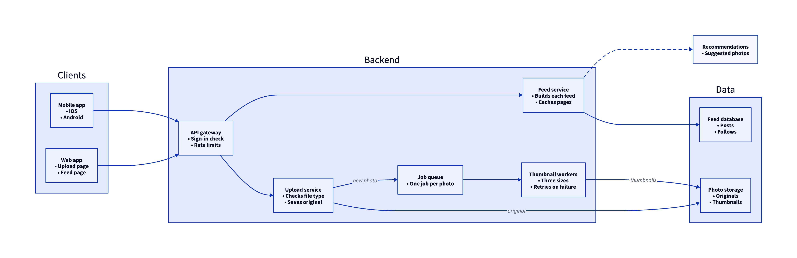
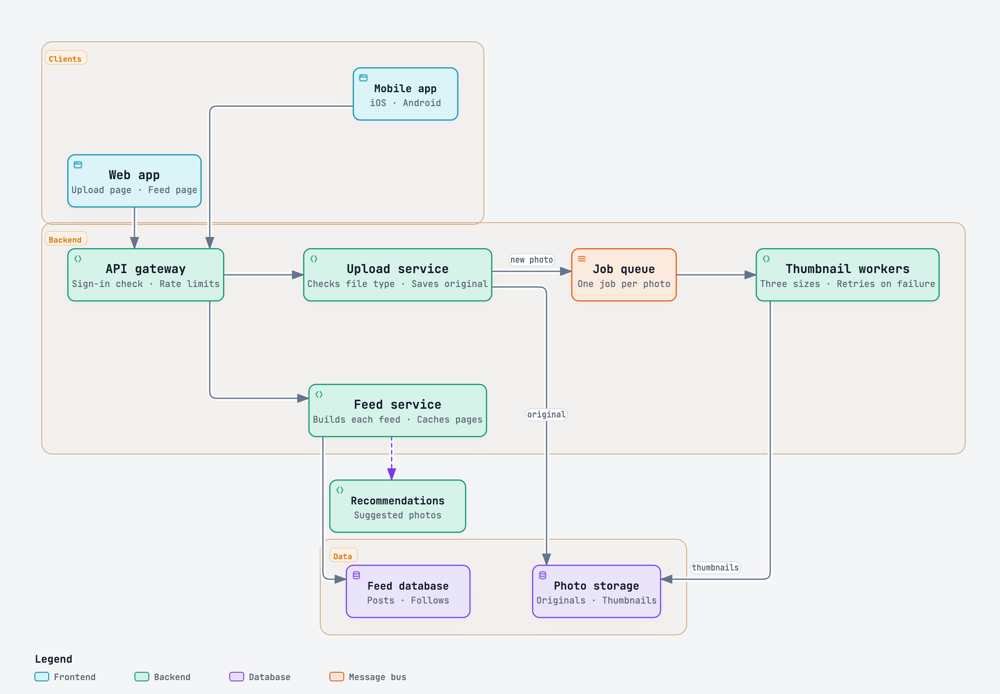

# How open-diagram-rs compares

Each tool below drew the same photo upload flow from its own input format, with default settings. [compare/README.md](compare/README.md) lists the source files, tool versions and exact commands.

| Tool | Input | Layout | Checks the layout | Output | MCP server | License | Price |
| --- | --- | --- | --- | --- | --- | --- | --- |
| [open-diagram-rs](https://github.com/Orrae-Labs/open-diagram-rs) | Rust, JSON, Mermaid | Automatic | Yes | SVG, PNG | Yes | MIT | Free |
| [Mermaid](https://mermaid.js.org) | Text | Automatic | No | SVG, PNG, PDF | Yes | MIT | Free; paid app from $10 a user a month |
| [D2](https://d2lang.com) | Text | Automatic | No | SVG, PNG, PDF, PowerPoint, GIF | No | MPL-2.0 | Free |
| [draw.io](https://www.drawio.com) | Editor | By hand | Only in its MCP viewer | PNG, SVG, PDF and more | Yes | Apache-2.0 | Free |
| [Excalidraw](https://excalidraw.com) | Editor | By hand | Only in its paid MCP server | PNG, SVG | Yes | MIT | Free; Plus from $6 a user a month |
| [archify](https://github.com/tt-a1i/archify) | JSON | Automatic | Yes | Interactive HTML page | No | Apache-2.0 | Free |

An MCP server lets AI apps such as Claude and Cursor use the tool directly.

The times below run from starting the command to the finished SVG. Each is the median of five runs on one Mac, after one warm-up run.

## open-diagram

0.59 s, with 0 layout problems. [Source](compare/photo-upload.json)

This picture and its time come from open-diagram 0.5.0, the Python project that open-diagram-rs is ported from. open-diagram-rs reads the same JSON, but it hasn't been timed on this comparison yet.

## Mermaid

0.76 s. [Source](compare/photo-upload.mmd)

## D2

0.017 s. [Source](compare/photo-upload.d2)

## Excalidraw

0.020 s, converted from the Mermaid file inside the browser. Excalidraw has no command, so the time covers only the conversion and export, after the page and its libraries had loaded. [Source](compare/photo-upload.mmd)

## archify

0.28 s, and its layout checks passed. [Source](compare/photo-upload.architecture.json)
