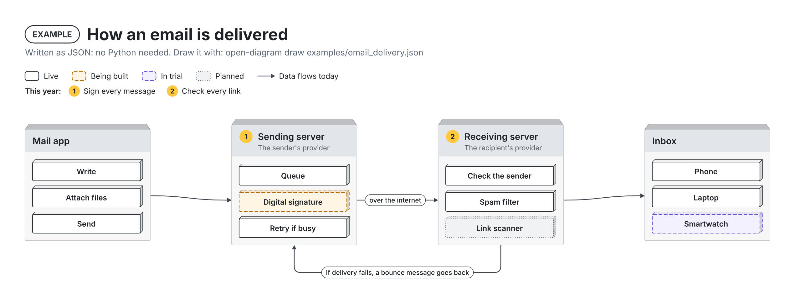
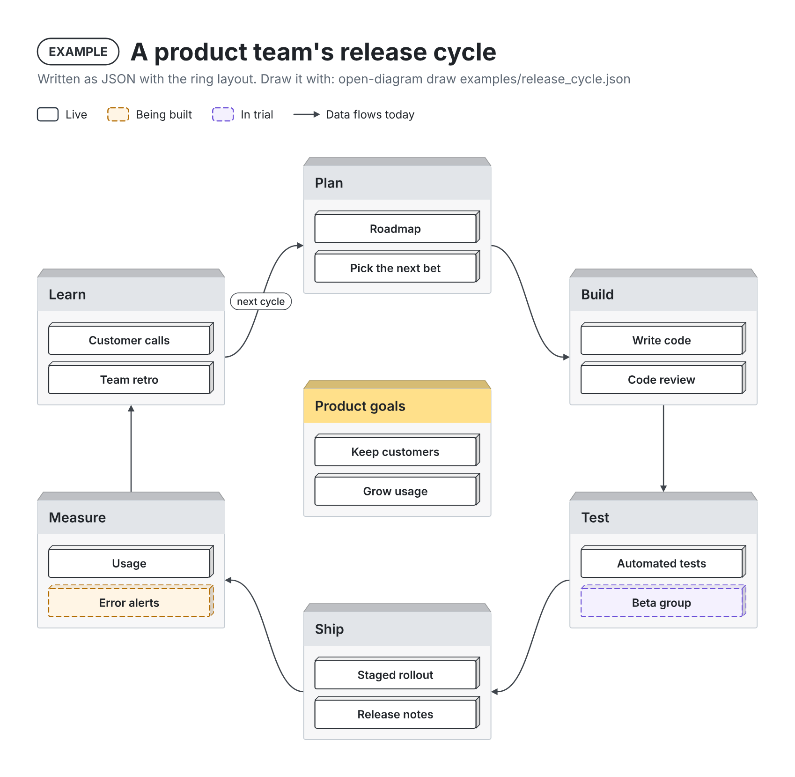

# JSON

A JSON description is plain data, so any language, script or AI agent can write one. This is a small one:

```json
{
  "title": "How an email is delivered",
  "columns": [
    [{"id": "app", "title": "Mail app", "tiles": ["Write", "Send"], "cols": 1}],
    [{"id": "out", "title": "Sending server", "tiles": ["Queue", {"label": "Digital signature", "status": "building"}]}]
  ],
  "links": [{"from": "app", "to": "out"}]
}
```

The full version of this example is [examples/email_delivery.json](../examples/email_delivery.json):



A mistake in a file is reported with its location, for example `columns[0][0].tiles[2]: unknown key(s) 'colour'`. From Rust, `open_diagram_rs::from_spec` reads the same format.

## Top level

`title` is required. Choose one layout:

- `columns`: a list of columns, each a list of panels, drawn left to right.
- `ring`: panels placed around a circle. Optional `center` holds panels for the middle, and `start_angle` turns the ring.
- `panels`: panels placed where you say, each with its own `x` and `y`.
- `resources`: large cloud icons placed by `x` and `y`, alone or together with `panels`. The [cloud templates](../crates/open-diagram/templates/README.md) use this layout.

Optional keys:

| Key | Meaning |
| --- | --- |
| `subtitle` | A line under the title |
| `tag` | A short label in a pill before the title, such as `EXAMPLE` |
| `note` | A boxed note in the top right, with `title` and `lines` |
| `steps` | Numbered steps shown in the legend, such as `[[1, "Order placed"], [2, "Paid"]]`. A panel's `step` puts the matching number on that panel |
| `steps_label` | The word before the steps in the legend. The default is `Steps` |
| `gap`, `row_gap` | Space between columns, and between panels in a column |
| `valign` | Vertical alignment of columns: `top`, `center` or `bottom` |
| `groups` | Shaded areas around panels |
| `enclosures` | Boxes around resources, panels or other enclosures |
| `links` | Lines between panels or resources |
| `statuses` | States by name, as in the [statuses file](cli.md#track-state-in-one-file) |
| `theme` | Colors and sizes. `link_labels` names a kind of line in the legend, such as `{"link_labels": {"flow": "Sends mail"}}`. Kinds you leave out keep their default names |
| `legend` | `false` hides the legend |
| `routing` | `curved` (the default) or `orthogonal`, which draws every line as straight runs that meet at right angles |

## Panel

A panel is the main box: a header with its title, then its contents.

`title` is required. The other keys are `id` (what links and groups use to refer to it), `sub`, `status`, `step` (a number badge), `footer` (such as `"Owner: Data team"`), `tone` (`accent` for a soft yellow header, `dark` for charcoal) and `width`. In the `panels` layout, a panel also takes `x` and `y`.

The contents are either:

- `tiles`, a list of tiles, with `cols` for the number of tile columns and `label` for a heading above them, or
- `sections`, a list where each item is one of `{"tiles": [...]}`, `{"text": "..."}`, `{"card": {...}}`, `{"graph": {...}}` or `{"row": [...]}`.

## Tile

A tile is a string, or an object with `label`, `sub`, `status` and `icon`.

## Resource

A resource is a large icon with its label underneath. `label`, `x` and `y` are required. It also takes `id`, `sub` (the cloud service's name, shown under the label), `icon`, `icon_size`, `max_width` and `border`.

## Enclosure

An enclosure draws a box around resources, panels or other enclosures, such as a network or an account. `label` and `members` are required. It also takes:

- `id`, `sub` and `pad`.
- `border`: `solid`, `dashed` or `dotted`.
- `style`: `outline`, or `panel` for a sloped lid and a filled header.
- `fill`, `stroke` and `tone`.

List enclosures from the inside out. An enclosure must come before any enclosure that holds it.

## Icon

An icon is a name inside an icon folder, such as `aws/s3`. The name is looked up in the built-in icons, in the JSON file's own folder, and in any folder given with `--icons`. Absolute paths and `..` are refused, so a diagram file can't read other files on the computer.

## Link

`from` and `to` are required: the ids of two panels or resources. The other keys are:

| Key | Meaning |
| --- | --- |
| `kind` | `flow` (the default) or `planned`, which draws a dotted line |
| `label` | Text on the line |
| `start`, `end` | The side the line leaves from and arrives at, or `auto` for the side facing the other end. `auto` is the default in the `ring` and `panels` layouts |
| `lane` | `top` or `bottom`, to route the line around the outside of the picture |
| `via_x`, `via_y` | A position the line must pass through |
| `cross_ok` | Allows this line to cross other panels without a problem being reported |
| `dash` | `solid`, `dashed` or `dotted`, set independently of `kind` |
| `routing` | `curved` or `orthogonal` for this link only, overriding the top-level `routing` |

## Group

A group is a shaded area around panels. It takes `label`, `members` (panel ids) and `sub`.

## Rings and free placement

A cycle reads best as a ring. Use `ring` instead of `columns`, optionally with panels in `center`. Links in a ring leave from the sides that face each other.



The source is [examples/release_cycle.json](../examples/release_cycle.json).

For any other shape, use `panels` and give each panel an `x` and `y`. In Rust, the equivalents are `Diagram::ring`, `Diagram::add` and `LinkSpec::start("auto").end("auto")`.
