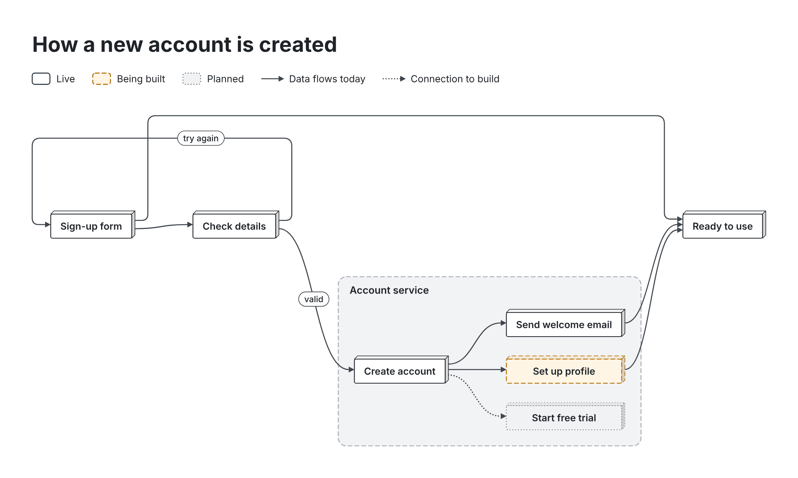

# Mermaid

open-diagram-rs can draw a Mermaid flowchart you already have. It reads the nodes, lines and subgraphs, then lays the picture out again with its own measuring and checks:

```bash
open-diagram-rs draw signup_flow.mmd
```



The source is [examples/signup_flow.mmd](../examples/signup_flow.mmd). From Rust, `open_diagram_rs::from_mermaid` reads the same input.

## What carries over

- `flowchart` and `graph`, in any direction: `LR`, `RL`, `TD`, `TB` or `BT`. `RL` and `BT` are drawn as mirror images of `LR` and `TD`.
- Nodes in any bracket shape, with or without quotes.
- Chains (`A --> B --> C`) and `&` (`A & B --> C`).
- Line labels: `-->|text|`, `-- text -->`, `-. text .->` and `== text ==>`.
- Dotted lines (`-.->`), which become connections still to be built and are drawn dotted.
- Each top-level `subgraph` ... `end`, which becomes a shaded group. Each group gets its own band, so it never covers nodes outside it.
- A class named after a state, which sets that state: `A:::building` or `class A,B planned`. The states are `live`, `building`, `trial`, `planned` and `retiring`.
- A `title:` in the front matter. Without one the title is "Flowchart". `--title` on the command line overrides both.
- Mermaid's `curve` setting. `step`, `stepBefore` and `stepAfter` draw right-angle lines, and any other curve draws smooth ones. It is read from the front matter (`config:`, then `flowchart:`, then `curve: step`) or from a `%%{init: {"flowchart": {"curve": "step"}}}%%` directive, which may span several lines. From Rust, `from_mermaid_with(text, None, None, Some("orthogonal"))` sets the routing directly.
- `%%` comments, and `;` between statements.

## What changes

- open-diagram-rs chooses the layout. Nodes are placed in steps by their longest path from the start. Lines that skip a step or point backwards run in a lane above or below the picture.
- Every node is drawn as the same box. Diamonds, circles and other shapes are not kept.
- `<br/>` becomes a space. A label written over several lines is drawn as one line and wrapped to fit.
- Thick lines (`==>`), lines without an arrowhead (`---`), circle and cross ends (`--o`, `--x`) and two-way arrows (`<-->`) are all drawn as ordinary one-way arrows.
- A subgraph inside another subgraph is merged into the outer one.
- Class names that are not states are ignored, and so are the styling statements `classDef`, `style`, `linkStyle`, `click` and `direction`.
- Markdown strings and icons such as `fa:fa-car` are shown exactly as typed.

## What it rejects

- Other Mermaid diagram types, such as `sequenceDiagram`. The error names the line.
- The newer shape syntax, `A@{ shape: ... }`. The error names the node.

open-diagram-rs has no reader for D2 files.
